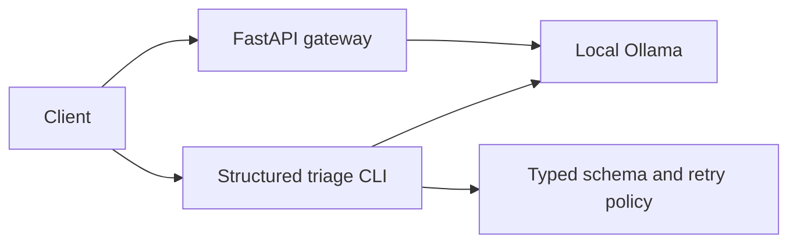

# AI Service Foundations

GitHub repository: [Techassrg/ai-service-foundations](https://github.com/Techassrg/ai-service-foundations).

Two independent Python projects show how to expose and validate local LLM capabilities behind explicit contracts.

| Project | Engineering problem | Run |
| --- | --- | --- |
| [Python AI API Starter](projects/python-ai-api-starter/README.md) | Safely expose local inference through a bounded HTTP contract | `cd projects/python-ai-api-starter && python -m uvicorn ai_api_starter.app:app` |
| [LLM Structured Output](projects/llm-structured-output/README.md) | Convert unreliable model text to validated incident records | `cd projects/llm-structured-output && python -m llm_structured_output.cli` |

Use each project's `pyproject.toml` to install locally. Tests use deterministic fake providers and cost nothing. The Ollama commands require a locally running model and have not been live validated in this environment. The first two projects are published; the remaining sprint project groups are planned locally and will be added in daily increments after validation.
