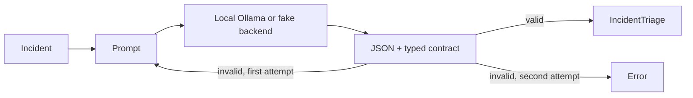

# LLM Structured Output

This project converts model output into a typed incident triage record. It rejects extra fields, invalid severity or team values, malformed JSON, and large output. One corrective retry handles a common model failure; a second failure returns an explicit error instead of unvalidated data.



## Run

From this directory with Python 3.10+:

```bash
python -m pip install -e '.[test]'
python -m pytest -q
ollama pull llama3.2:3b
ollama serve
python -m llm_structured_output.cli 'Synthetic payment API timeouts increased after a test deployment.'
```

Set `OLLAMA_MODEL`, `OLLAMA_BASE_URL`, or `OLLAMA_TIMEOUT_SECONDS` for a different local setup. Model output is untrusted data, even when Ollama is asked for JSON. The typed schema remains the source of truth.

## Evaluation

On October 15, 2026, **7/7 tests passed** with Python 3.11.7 using `python -m pytest -q`. The deterministic tests cover valid output, malformed data, extra fields, retry recovery, retry exhaustion, and pre-call input rejection. These results validate the parser and control flow. They do not measure model accuracy or latency; live Ollama validation is pending.
