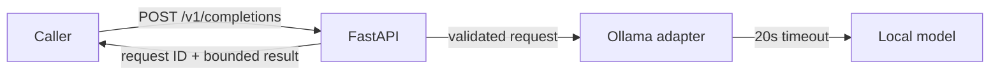

# Python AI API Starter

A local inference gateway for applications that need a stable HTTP contract around Ollama. It validates request size and model names, emits a request ID, bounds provider responses, and maps provider failures to a safe `503` response. The model is never invoked in tests.



## Run

Python 3.10+ and a local Ollama installation are required for live inference. From this directory:

```bash
python -m pip install -e '.[test]'
ollama pull llama3.2:3b
ollama serve
python -m uvicorn ai_api_starter.app:app --host 127.0.0.1 --port 8000
```

In another terminal:

```bash
curl -sS http://127.0.0.1:8000/v1/completions \
  -H 'content-type: application/json' \
  -H 'x-request-id: api-demo-1' \
  -d '{"prompt":"Summarize a synthetic payment timeout in one sentence."}'
```

Set `OLLAMA_BASE_URL` and `OLLAMA_TIMEOUT_SECONDS` to change the local provider connection and timeout. The API limits prompt length to 4,000 characters and output length to 20,000 characters. It does not claim production authentication or rate limiting; place it behind an authenticated gateway before network exposure.

## Evaluation

Run `python -m pytest -q`. On October 15, 2026, **4/4 tests passed** with Python 3.11.7. They check a successful request, invalid input rejection, safe provider failure, and oversized output rejection. These are deterministic offline contract tests. Live model latency and quality have not been measured.
